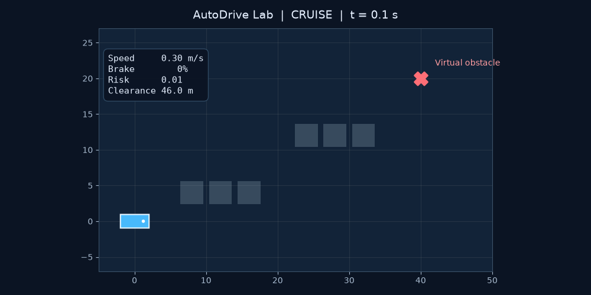
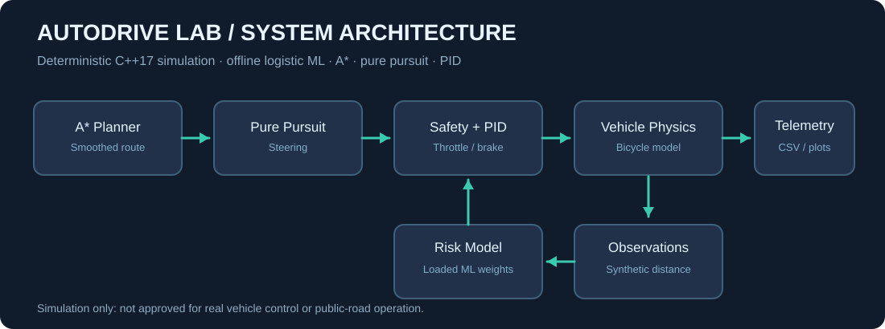
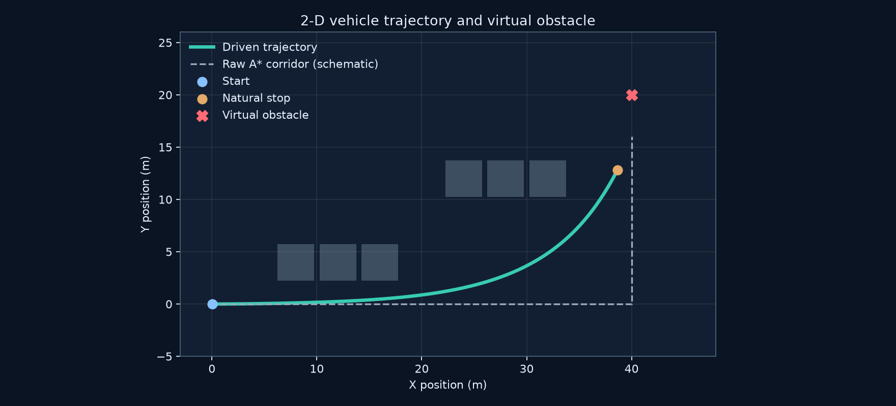
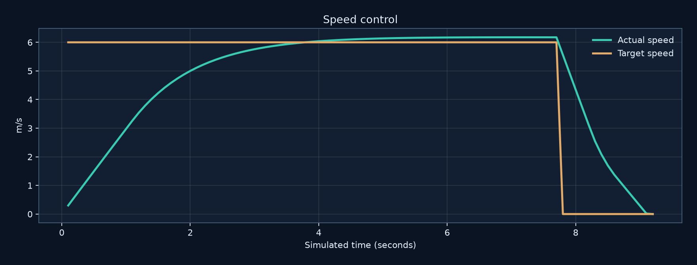
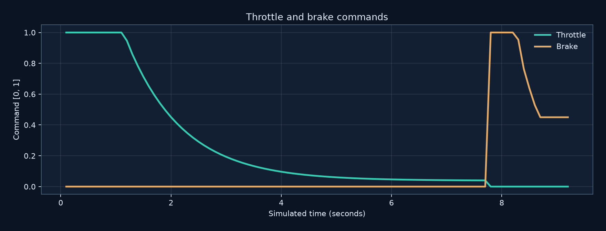
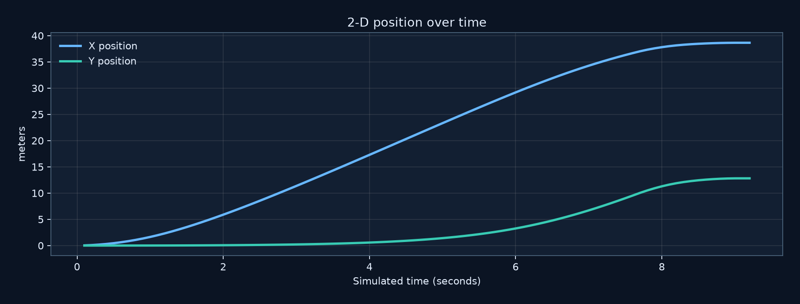
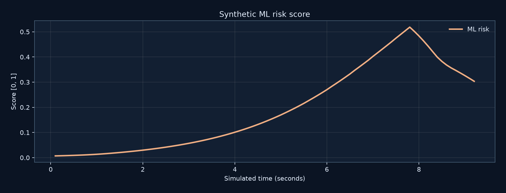

# AutoDrive Lab 🚘

**C++17 autonomous-driving educational simulator • A* planning • 2D pure-pursuit steering • longitudinal PID • synthetic ML risk • automated safety regression tests • animated visualizations**

[](https://github.com/Jashwanth248/Self_driving_car/actions/workflows/ci.yml)

> **Safety & scope:** This is an **industry-style learning/portfolio project**, **not an industry-qualified self-driving stack**. It simulates an idealized vehicle and virtual obstacle. Do not connect its output to a physical steering, brake, or throttle system.



**[Watch the MP4 demo](docs/assets/autodrive_demo.mp4)** · **[Architecture](docs/ARCHITECTURE.md)** · **[Telemetry CSV](docs/assets/telemetry.csv)**

## What you see

- A* produces a grid route around obstacles, and the route is smoothed into continuous waypoints.
- Pure pursuit controls a bicycle-model vehicle's **2D steering**. This really turns the virtual vehicle, unlike the earlier straight-line demo.
- A logistic-regression ML model is trained **offline on deterministic synthetic observations**; its numerical weights are saved under `config/` and loaded during simulation.
- The safety state machine follows `CRUISE → BRAKING → STOPPED` or reports `FAULT` on clearance violation.
- The speed PID controls throttle and braking; braking begins early enough to stop naturally without teleporting the car.
- Every step writes structured CSV telemetry that powers the images and GIF/MP4.



## Driving trajectory and graphs



| Speed | Throttle & brake |
|:--:|:--:|
|  |  |

| Position | ML risk |
|:--:|:--:|
|  |  |

## Build & run

Requires **CMake >=3.16** and a C++17 compiler (GCC, Clang or Visual Studio).

```bash
cmake -S . -B build -DCMAKE_BUILD_TYPE=Debug
cmake --build build --config Debug
ctest --test-dir build -C Debug --output-on-failure
```

From the project root, run the demo:

```bash
# Linux / macOS
./build/autodrive_demo --model config/risk_model.txt --output telemetry.csv
# Windows Visual Studio generator
.\build\Debug\autodrive_demo.exe --model config/risk_model.txt --output telemetry.csv
```

You should see `PASS: natural stop ...` and a `telemetry.csv` file.

### Retrain the simple ML model (optional)

```bash
./build/autodrive_train config/risk_model.txt
```

Training is a separate executable. The demo **never trains at startup**.

### Regenerate pictures and video

```bash
python -m pip install -r requirements-viz.txt
python scripts/render_demo.py --csv telemetry.csv --out docs/assets
```

For MP4 creation you also need FFmpeg installed. The script creates a GIF and all charts without FFmpeg.

## Testing and engineering quality

- Unit tests: A*, error handling, PID, ML input validation and ordering.
- End-to-end scenarios at four maximum speeds (3.0, 4.5, 6.0, 7.5 m/s).
- Each scenario checks obstacle clearance, bounded speed, actual braking, steering, route tracking and stable stopped state.
- GitHub Actions: Linux Debug/Release, Windows Debug, sanitizer build, and visualization artifact generation.
- Explicit output CSV fields include position, heading, speed, risk, throttle, brake, steering, state and boundary violation.

## Where to read the code

1. `src/main.cpp` — starts the executable, loads the model and runs the loop.
2. `src/simulation.cpp` — **main execution sequence**, observations → risk → safety → PID/steering → physics → telemetry.
3. `src/planning.cpp` — A* and route lookahead.
4. `src/control.cpp` — speed PID and pure-pursuit steering.
5. `src/perception.cpp` — offline logistic training and model inference.
6. `tests/test_autodrive.cpp` — unit and end-to-end tests.
7. [`docs/ARCHITECTURE.md`](docs/ARCHITECTURE.md) — more design details and limitations.

### Recommended future work

A CARLA/ROS 2 adapter, timestamped sensor buses, camera-based perception, multi-agent prediction, richer tire and brake dynamics, scenario coverage metrics, CI code coverage and stronger validation are **not implemented** in this version.
